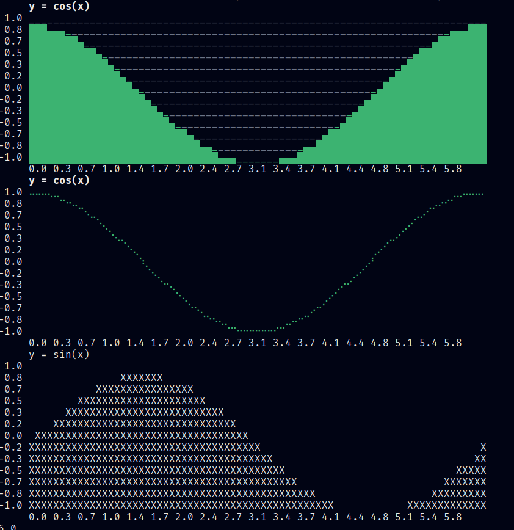
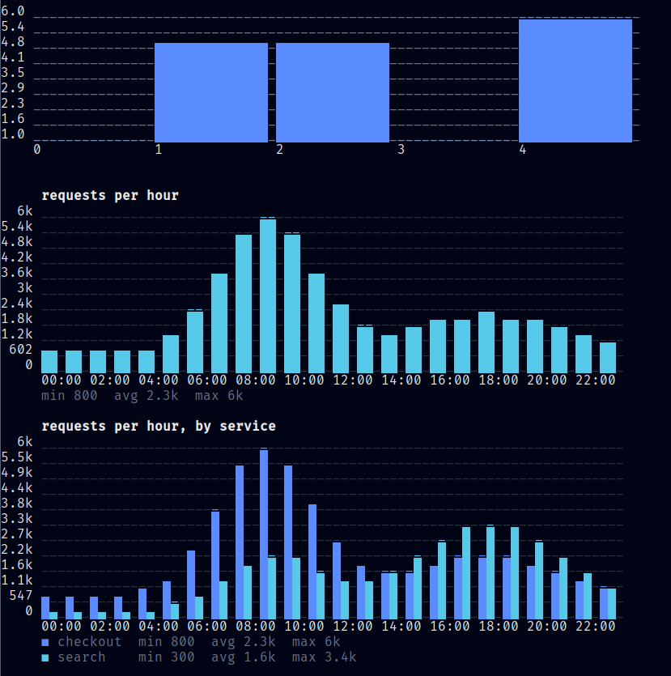

# Babar

## CLI bar charts for node.js

Babar is a simple node.js library to draw bar charts in your console.



While it isn't an advanced charting library, it can be useful to get a rought idea of:

* whether some data is random or not
* whether some data is linear, exponential, etc ...


### Features:

* easy to use
* lightweight: one minified file of less than 9 kB, no dependency
* color output
* ASCII output
* automatically bucketizes values (average, sum, min, max, last or count of the values of a bucket)
* vertical or horizontal bars, numeric, categorical or time x axis, linear or log y axis, reference line
* human units, several series with a legend and a summary
* lines drawn with braille characters
* TypeScript types
* MIT license

### Limitations:

* limited accuracy
* no stacked bars, no negative bars: a bar goes from the bottom of the chart to its value

## Installation

```bash
npm install babar
```

Babar needs Node 22 or later.

## Usage

Babar exposes a function whose signature expects at least an array of points, where a point is an array of two values `[x, y]`. It returns a string representation of the data which can be output to your console.

```js
var babar = require('babar');
console.log(babar([[0, 1], [1, 5], [2, 5], [3, 1], [4, 6]]));
```

While it does its best to render the data automatically, you can also pass along some options.

```js
var babar = require('babar');

console.log(babar([[0, 1], [1, 5], [2, 5], [3, 1], [4, 6]], {
  color: 'green',
  width: 40,
  height: 10,
  maxY: 10,
  yFractions: 1
}));
```

### Importing

The package is a CommonJS module whose export is the function, as in 0.2.3. The function is also its own `babar` and `default` properties, so all of these give the same function:

```js
const babar = require('babar');
const { babar } = require('babar');
```

```js
// ES modules (Node, bundlers)
import babar from 'babar';
import { babar } from 'babar';
```

```ts
// TypeScript, with or without esModuleInterop
import babar from 'babar';
import { babar, type Options, type Point } from 'babar';
import babar = require('babar'); // the types are then babar.Options, babar.Point, ...
```

The exported types are `Options`, `Point`, `CategoricalPoint`, `AnyPoint`, `Series`, `Color`, `Style`, `Aggregation`, `YScale`, `Direction` and `Unit`.

`examples/typescript.mts` draws a time series, then two series, with typed options and points. `npm run typecheck` checks it, and Node 22.18 or later runs it as is: `node examples/typescript.mts`.

## Options

The options of 0.2.3:

* **caption**: specify a caption to display over the bar chart
* **color="cyan"**: specify a color ('yellow', 'cyan', 'white', 'magenta', 'green', 'red', 'grey', 'blue', or 'ascii')
* **grid="black"**: specify a color ('yellow', 'cyan', 'white', 'magenta', 'green', 'red', 'grey', 'blue')
* **width=80**: output will fit in specified width
* **height=15**: output will fit in specified height
* **xFractions**: number of fractions for x labels, does its best by default
* **yFractions**: number of fractions for y labels, does its best by default
* **minX**: minimum x value for x axle
* **maxX**: maximum x value for x axle
* **minY**: minimum y value for y axle
* **maxY**: maximum y value for y axle

With these options alone a chart is, byte for byte, the chart 0.2.3 rendered.

`color` and `grid` also take the other static style names of the `colors` package that 0.2.3 used (`gray`, `black`, `brightRed`, `bgBlue`, `redBG`, `underline`, `inverse`, ...), with the same output.

Other names are not validated. With the options of 0.2.3 alone they print what 0.2.3 printed wherever it returned a chart, because 0.2.3 read the name on the character itself (`'_'[name]`):

* The styles `colors` generated: `zebra`, `strip` and `stripColors` leave the characters as they are, and `rainbow` and `america` draw them red, exactly as in 0.2.3 (on a single character that is all these styles did). `random`, `trap` and `zalgo` drew at random in 0.2.3 (a random colour, look-alike or decorated characters): here they leave the characters as they are, which is the one documented difference in what is drawn. The names of a theme set with `colors.setTheme` are not known.
* A name every string has, like `length`, `constructor`, `toString` or `__proto__`: 0.2.3 printed the value found there, and so does babar. `grid: 'length'` fills the grid with `1`, `grid: 'constructor'` with the source text of a function, `grid: '__proto__'` with nothing. It is what 0.2.3 did, not a feature.
* Any other name (`grid: 'ascii'`, `grid: 'nope'`): the grid is filled with commas and the word `undefined`, as in 0.2.3. For `color`, 0.2.3 threw as soon as a bar was tall enough to have a body: that body is drawn unstyled.

With any of the options below, a name that is not a static style leaves the bars or the grid unstyled.

`caption` is a string. With the options of 0.2.3 alone and colours (any `color` but `'ascii'`), a caption that is not a string (`0`, `false`, `NaN`, an object) is printed as `undefined`, as in 0.2.3, which read the bold style on the caption itself; with `color: 'ascii'`, or any option below, it is converted to a string.

The options added since, all off by default:

| Option | Values | Effect |
| --- | --- | --- |
| `style` | `'bars'` (default), `'braille'` | `'braille'` draws a line of braille characters in place of the bars |
| `aggregation` | `'avg'` (default), `'sum'`, `'min'`, `'max'`, `'last'`, `'count'` | what a bar shows of the points of its bucket |
| `yScale` | `'linear'` (default), `'log'` | logarithmic y axis |
| `refY` | a number | draws a reference line at this y value |
| `direction` | `'vertical'` (default), `'horizontal'` | `'horizontal'` draws one row per bar |
| `xType` | `'time'` | the x values are epoch milliseconds or `Date` objects, labelled as times or dates |
| `utc` | `true` (default), `false` | with `xType: 'time'`, `false` prints the labels in the local time zone |
| `xFormat` | `(value) => string` | formats the x labels itself (the value is a number) |
| `unit` | `'short'`, `'bytes'`, `'percent'` | formats the y labels and the summary: 1.2k, 1.5KiB, 12% |
| `yFormat` | `(value) => string` | formats the y labels and the summary itself |
| `summary` | `false` (default), `true` | prints `min`, `avg` and `max` of the points of each series under the chart |
| `forceColor` | detected (default), `true`, `false` | switches the ANSI colours on or off, whatever the environment says |

A categorical x axis and several series come with the points, not with an option: see below.

As soon as one of them is used (an aggregation other than `'avg'`, `yScale: 'log'`, a finite `refY`, `direction: 'horizontal'`, `style: 'braille'`, `xType`, `xFormat`, `unit`, `yFormat`, `summary`, labels as x values, several series), the chart is no longer bound to what 0.2.3 printed (`forceColor` alone keeps the chart of 0.2.3):

* a flat series is drawn at mid height, a single x value is drawn with its label, and an input without points gives an empty chart, where the options of 0.2.3 print `NaN` labels;
* the output fits in `width` and `height`, from 1 by 1. What does not fit is dropped in this order: the legend and the summary (see below), the caption (under a `height` of 3), the x labels (under a `height` of 2), the y labels (when they would leave no column to the chart). A caption longer than the chart is cut;
* without colours, vertical bars are filled with `X` as with `color: 'ascii'`, where the options of 0.2.3 keep its underscores.

None of these options throws on a value it does not know: the chart is drawn as if the option was not given (see each option).

### Aggregation

When several points fall in the same bucket, the bar shows their average. `aggregation` picks something else: `'sum'`, `'min'`, `'max'`, `'last'` (the last point in the order of the array) or `'count'` (the number of points).

```js
babar([[0, 2], [0, 4], [0, 6], [1, 10]], {aggregation: 'sum', color: 'ascii', width: 24, height: 7, minY: 0});
```

```
12                     
10 XXXXXXXXXX          
 7 XXXXXXXXXXXXXXXXXXXX
 5 XXXXXXXXXXXXXXXXXXXX
 2 XXXXXXXXXXXXXXXXXXXX
 0 XXXXXXXXXXXXXXXXXXXX
   0.0       1.0       
```

* With an aggregation other than `'avg'` the y axis follows the values of the bars (with `'avg'` it follows the y values of the points, as in 0.2.3). Sums and counts usually want `minY: 0`: by default the y axis starts at the lowest bar.
* A bucket without points has a sum and a count of 0. With the other aggregations it repeats the value of the bucket before it, as the average does.
* An unknown aggregation is the average.
* It applies to bars. A braille line always averages the points of a dot.

### Log scale

`yScale: 'log'` spaces the powers evenly, for data that grows exponentially.

```js
babar([[0, 1], [1, 10], [2, 100], [3, 1000]], {yScale: 'log', color: 'ascii', width: 30, height: 8});
```

```
1000                         
 316                   XXXXXX
 100                   XXXXXX
  32             XXXXXXXXXXXX
  10             XXXXXXXXXXXX
   3       XXXXXXXXXXXXXXXXXX
   1       XXXXXXXXXXXXXXXXXX
     0     1     2     3     
```

A log scale needs positive values: when a y value, `minY` or `maxY` is zero or negative, or on an unknown `yScale`, the axis is linear.

### Reference line

`refY` draws a line across the chart at a y value, over the bars it does not reach: dashes (`╌`, in the colour of the grid) or `-` in ascii. With horizontal bars it is a column (`╎`, or `|` in ascii).

```js
babar([[0, 0], [1, 5], [2, 10]], {refY: 5, color: 'ascii', width: 40, height: 8});
```

```
10                                     
 8                         XXXXXXXXXXXX
 7                         XXXXXXXXXXXX
 5 ------------            XXXXXXXXXXXX
 3             XXXXXXXXXXXXXXXXXXXXXXXX
 2             XXXXXXXXXXXXXXXXXXXXXXXX
 0             XXXXXXXXXXXXXXXXXXXXXXXX
   0           1           2           
```

A `refY` that is not a finite number, or outside the y axis, draws no line. A braille chart has no reference line.

### Categorical x axis

When the x values are strings, each distinct label is a bar, in the order the labels first appear. Points with the same label go in the same bar (averaged, or aggregated).

```js
babar([['Jan', 10], ['Feb', 25], ['Mar', 15], ['Apr', 40], ['May', 30]], {color: 'ascii', width: 60, height: 10});
```

```
40                                                        
36                                  XXXXXXXXXXX           
33                                  XXXXXXXXXXX           
29                                  XXXXXXXXXXX           
25                                  XXXXXXXXXXXXXXXXXXXXXX
21            XXXXXXXXXXX           XXXXXXXXXXXXXXXXXXXXXX
18            XXXXXXXXXXX           XXXXXXXXXXXXXXXXXXXXXX
14            XXXXXXXXXXX           XXXXXXXXXXXXXXXXXXXXXX
10            XXXXXXXXXXXXXXXXXXXXXXXXXXXXXXXXXXXXXXXXXXXX
   Jan        Feb        Mar        Apr        May        
```

* As soon as one x value is a string, every x value is taken as a label (`2` is the label `'2'`).
* When there are more labels than columns, neighbouring labels share a bar, as numeric x values do, and only some labels are printed. Labels are never cut: when they are too long to all fit under the bars, every second one is printed, then every fourth one, and so on.

### Horizontal bars

`direction: 'horizontal'` draws one row per bucket: its x label, its bar, its value. The bars are drawn with eighth-block characters (`▏▎▍▌▋▊▉█`), so they are accurate to an eighth of a column; in ascii a bar is made of `X`, rounded to the column.

```js
babar([[0, 10], [1, 50], [2, 30], [3, 80], [4, 20]], {direction: 'horizontal', refY: 40, color: 'ascii', width: 50});
```

```
0 ...................|......................... 10
1 XXXXXXXXXXXXXXXXXXXXXXXXXX................... 50
2 XXXXXXXXXXXXX......|......................... 30
3 XXXXXXXXXXXXXXXXXXXXXXXXXXXXXXXXXXXXXXXXXXXXX 80
4 XXXXXX.............|......................... 20
```

* There are as many rows as distinct x values, up to `height` (one less with a caption); beyond, neighbouring x values share a row.
* The bar of the lowest value is empty unless `minY` says where the bars start.
* On a `width` that has no room for them, the values go first, then the labels.
* An unknown `direction` is vertical. With `style: 'braille'` the direction is not used.

### Braille lines

`style: 'braille'` draws a line in place of the bars. Each character of the chart is a matrix of 2 by 4 dots (Unicode U+2800 to U+28FF), so a chart of 70 by 10 characters has 140 by 40 dots. Every horizontal dot holds one point of the line: the average of the points that fall on it when there are more points than dots, a linear interpolation between the points when there are fewer. Consecutive dots are joined vertically, so a steep change leaves no gap. A character without dot is a space, and there is no grid: `grid` is not used.

```js
var points = [];
for (var i = 0; i < Math.PI * 2; i += Math.PI / 1000) {
  points.push([i, Math.cos(i)]);
}
console.log(babar(points, {style: 'braille', color: 'ascii', width: 60, height: 8}));
```

```
 1.0 ⠤⠤⠤⠤⣀⡀                                           ⣀⡠⠤⠤⠤⠄
 0.7      ⠈⠑⠢⢄                                    ⢀⠤⠒⠉      
 0.3          ⠉⠒⢄⡀                             ⣀⠔⠊⠁         
 0.0             ⠈⠢⢄                        ⢀⠤⠊             
-0.3                ⠉⠢⢄⡀                 ⣀⠤⠊⠁               
-0.7                   ⠈⠒⠤⣀          ⢀⡠⠔⠊                   
-1.0                       ⠉⠑⠒⠒⠒⠒⠒⠒⠒⠉⠁                      
     0.0 0.5 0.9 1.4 1.9 2.3 2.8 3.3 3.7 4.2 4.7 5.1 5.6 
```

* A value above `maxY` or below `minY` is drawn on the top or bottom dot; a point outside `minX`..`maxX` is ignored.
* When there are more distinct x values than characters in the width, the x labels are spread evenly and do not fall on round values.
* With a single row of characters the line is flat: the y scale needs two rows.

Several series are drawn as one line each, see below.

### Several series and their legend

Several series are passed as an array of `{name, points, color}` in place of the array of points:

```js
babar([
  {name: 'checkout', points: [[0, 1], [1, 5], [2, 5]]},
  {name: 'search', points: [[0, 2], [1, 3], [2, 1]], color: 'magenta'}
], {summary: true});
```

Each x bucket then holds one bar per series, on a shared x range and y scale, and a legend is printed under the chart. With `style: 'braille'` each series is a line. The series are coloured blue, cyan, magenta, yellow, green unless they say otherwise, and are named `series 1`, `series 2`, ... unless they say otherwise. With `color: 'ascii'`, or when colours are off, their bars are filled with `X`, `O`, `#`, `+`, `*`. Beyond five series the colours and the fills are used again.

The legend takes its lines from `height`, as long as the graph keeps two rows: the names share lines when they fit. What does not fit is dropped in this order:

1. the summary, when there are more series than lines left (the names then share lines);
2. the legend lines that are still too many;
3. on a narrow `width`, the end of a name that is alone on its line;
4. the bars of the last series, when `width` is smaller than the number of series.

In braille:

* When the lines of two series cross a same character, the character takes the colour of the last series of the array.
* Without colours (`forceColor: false`, `color: 'ascii'`, or an environment without colours) the lines are still drawn, but cannot be told apart: the legend then only shows their names.

Horizontal bars draw one data set: with `direction: 'horizontal'` only the first series is drawn, without legend. An entry of the array that is not a series is a series without points.

### Time axis

With `xType: 'time'` the x values are epoch milliseconds or `Date` objects. Labels are `HH:MM` when the x span is under 2 days, `DD/MM HH:MM` under 14 days, `DD/MM` under a year, `YYYY-MM` beyond. Under 2 days the labels stay `HH:MM` when the span crosses midnight: the date is not shown. They are in UTC unless `utc` is `false`.

`xFormat` formats the x labels itself, with or without `xType`.

An x value that is not a time does not throw: it is `NaN`, as any x that is not a number. An unknown `xType`, and an `xFormat` that is not a function, are ignored.

### Units

`unit` formats the y labels: `'short'` (1.2k, 3.4M, 5.6G), `'bytes'` (1024 based: B, KiB, MiB, GiB) or `'percent'` (12%). `yFormat` formats them itself, and wins over `unit`. Both also format the summary and the values of horizontal bars. A value too large for its unit is a short exponent rather than a long number: `1.0e+288T` beyond the last unit, `1.0e+15%` from 1e15 percent on. An unknown `unit`, and a `yFormat` that is not a function, are ignored.

### Summary

`summary: true` prints the `min`, `avg` and `max` of the points of each series under the chart, formatted like the y labels, one line per series. They are computed on the points, whatever the `aggregation`.

The summary takes its lines from `height`, as long as the graph keeps two rows. On a narrow `width` the `max`, then `avg`, then `min` cells go: a value is never cut in the middle. A series without points shows `-`.

`node examples/timeseries.js` draws the two charts below (here with `color: 'ascii'`): one value per hour over a day with `xType: 'time'`, `unit: 'short'`, `summary: true` and `minY: 0`, then the same for two series.

```
     requests per hour
  6k
5.4k                            XXX
4.8k                         XXXXXXXXX
4.2k                         XXXXXXXXX
3.6k                         XXXXXXXXX
  3k                      XXXXXXXXXXXXXXX
2.4k                      XXXXXXXXXXXXXXX
1.8k                   XXXXXXXXXXXXXXXXXXXXX               XXX
1.2k                   XXXXXXXXXXXXXXXXXXXXXXXX   XXXXXXXXXXXXXXXXXXXXX
 602                XXXXXXXXXXXXXXXXXXXXXXXXXXXXXXXXXXXXXXXXXXXXXXXXXXXXXXXXX
   0 XXXXXXXXXXXXXXXXXXXXXXXXXXXXXXXXXXXXXXXXXXXXXXXXXXXXXXXXXXXXXXXXXXXXXXXX
     00:00 02:00 04:00 06:00 08:00 10:00 12:00 14:00 16:00 18:00 20:00 22:00
     min 800  avg 2.3k  max 6k
```

```
     requests per hour, by service
  6k
5.5k                            X
4.9k                         X  X  X
4.4k                         X  X  X
3.8k                         X  X  X
3.3k                      X  X  X  X  X
2.7k                      X  X  X  X  X                  O  O  O
2.2k                      X  X  X  X  X  X            O  O  O  O  O
1.6k                   X  X  X  XO XO X  X         O  O XO XO XO  O  O
1.1k                   X  X  XO XO XO XO X  X  XO XO XO XO XO XO XO XO  O
 547             X  X  X  XO XO XO XO XO XO XO XO XO XO XO XO XO XO XO XO XO
   0 X  X  X  X  X  XO XO XO XO XO XO XO XO XO XO XO XO XO XO XO XO XO XO XO
     00:00 02:00 04:00 06:00 08:00 10:00 12:00 14:00 16:00 18:00 20:00 22:00
     X checkout  min 800  avg 2.3k  max 6k
     O search    min 300  avg 1.6k  max 3.4k
```

### How the options combine

Every combination returns a chart. What each of the options above does next to the others:

| | `aggregation` | `yScale: 'log'` | `refY` | categorical x | `direction: 'horizontal'` | `style: 'braille'` |
| --- | --- | --- | --- | --- | --- | --- |
| `xType`, `utc` | supported | supported | supported | ignored: the labels are the categories | supported: labels of the rows | supported |
| `xFormat` | supported | supported | supported | ignored: the labels are the categories | supported: labels of the rows | supported |
| `unit`, `yFormat` | supported: format the aggregated values | supported | supported | supported | supported: format the values of the rows | supported |
| several series | supported: each series is aggregated | supported | supported | supported: the series share the categories | first series only | supported: one line per series |
| legend | supported | supported | supported | supported | not printed | supported |
| `summary` | supported: it stays the min, avg and max of the points | supported | supported | supported | not printed | supported |
| `forceColor` | supported | supported | supported | supported | supported | supported |

`aggregation`, `refY` and `direction` are not used by `style: 'braille'`, as said above; `yScale: 'log'` and a categorical x axis are.

## Colours

Colours are ANSI escape codes. They are on when `FORCE_COLOR` is set (and not `0`), when `--color` is on the command line, or when `TERM` or `COLORTERM` describe a terminal with colours. They are off with `FORCE_COLOR=0`, `--no-color`, `NO_COLOR`, or in a CI that is not known to render them. Whether the output is a TTY is not looked at, so piped output keeps its colours.

The detection follows what the `colors` package did for 0.2.3 (flags, `FORCE_COLOR`, platform, CI, `TEAMCITY_VERSION`, `TERM_PROGRAM`, `TERM`, `COLORTERM`), with `NO_COLOR` added. It is done on each call.

`forceColor: true` or `forceColor: false` overrides all of this.

When colours are off, vertical bars drawn with the options of 0.2.3 alone keep the rendering 0.2.3 had without colours (underscores, not readable): pass `color: 'ascii'` there. With any of the other options they are drawn as with `color: 'ascii'`. Braille lines and horizontal bars keep their characters, without codes.

## Errors and limits

Babar does not validate its input and does not throw on the values of its options: an unknown value is ignored, a size too small gives what fits, and `null` options are no options.

It throws a `TypeError`:

- `babar: points must be an array of [x, y]`, when the points are not an array (`undefined`, `null`, a string, an object);
- from the engine, when a point is `null` or `undefined`, or when an x or y value is a `BigInt` or a `Symbol`;
- whatever an `xFormat` or `yFormat` function of yours throws.

A point that is not an array (`babar([1, 2])`) has no x and no y: it does not throw, and prints `NaN` labels, as do values that are not finite numbers (`NaN`, `Infinity`, strings as y values).

`width` and `height` are limited to 1000, either way: `Infinity` or `1e7` is 1000, `-Infinity` is -1000 (which, as in 0.2.3, draws rows without bars). With the options of 0.2.3 alone, a size that is not a number, a negative one or a fractional one gives what 0.2.3 gave. With any of the other options, sizes are whole numbers of at least 1 (`2.5` is 2, `0` and negative sizes are 1), and a size that is not a number is the default one.

## Changes for users of 0.2.3

The charts drawn with the options of 0.2.3 are byte-identical wherever 0.2.3 returned a chart, `NaN` labels included (an input without points, a single x value, a flat series, a `height` that leaves one row). What changes around them:

* A `width` too small for the chart, on which 0.2.3 hung or threw, returns what fits: the rows without their x labels, or the y labels alone.
* `xFractions` and `yFractions` outside 0..100 (`-1`, `101`), on which 0.2.3 threw a `RangeError`, are taken as 0 or 100.
* A `height` or `width` that 0.2.3 threw on (most negative sizes, some fractional ones, a `height` that leaves a single row to a chart with a caption) returns rows, usually without bars.
* A `caption` or a series `name` that cannot be turned into a string (a `Symbol`, an object without prototype) is an empty one; 0.2.3 threw on such a caption with `color: 'ascii'`.
* `require('babar')` no longer patches `String.prototype`: code that relied on `'text'.green` being available after loading babar has to depend on `colors` itself.
* `colors` is no longer installed with babar; babar has no dependency.
* `NO_COLOR` switches the colours off, unless `FORCE_COLOR` or `--color` asks for them.
* Of the generated styles of `colors`, `random`, `trap` and `zalgo` no longer change the characters or their colour, and the names of a theme set with `colors.setTheme` are not known. `zebra`, `strip`, `stripColors`, `rainbow`, `america` and all the static styles draw what they drew.
* An unknown `color` no longer throws on a bar that has a body: the body is drawn unstyled.
* `width` and `height` are limited to 1000 characters; `Infinity` and `-Infinity` no longer hang.
* The package needs Node 22 or later (`engines` says so, and the bundle is built for it); 0.2.3 declared no minimum.

## Changes from the TypeScript rewrite (`migrate_typescript`)

* Added: braille lines, several series with a legend, time axis, units, summary, `forceColor`, colour detection.

* Vertical bars are the ones of 0.2.3 (`_`, `▄` and full cells), not eighth blocks (`▁▂▃▄▅▆▇█`). Eighth blocks are only used by horizontal bars.
* There is no validation that throws: no `TypeError` or `RangeError` on empty points, non-finite values, unknown colours, aggregations, scales or directions, `width` or `height` under 3, `minX >= maxX`, `minY <= 0` with a log scale. Each of these draws a chart, as described above.
* A bucket without points has a sum and a count of 0 (it repeated the value before it).
* The values of a log scale are no longer clamped to a tiny positive number: the axis is linear when a value is not positive.
* `Color` covers the 50 style names of 0.2.3, not 11.

## Contributing

Working on babar needs Node 26.13.1: it is pinned in `.mise.toml` and `.nvmrc` (`mise install` or `nvm use`), and `devEngines` in `package.json` makes npm refuse to run the scripts with another version. That exact version only concerns development: the published package declares `engines.node >= 22`, is built for Node 22, typechecks against `@types/node` 22 and has no dependency. The tests also pass on Node 22 when run with `node_modules/.bin/vitest` (npm scripts need the pinned version).

## Development

The npm package contains `lib/babar.js` (the minified bundle), `lib/babar.d.ts`, `package.json`, the README and the license. The source (`src/babar.ts`), the examples, the tests and the screenshot are in the repository.

The bundle is built with `--target=node22`, the `engines` of the package (`>=22`).

```bash
npm install
npm run build       # esbuild bundle and type declarations in lib/
npm test            # builds, then vitest: compares the renderings with test/fixtures
npm run typecheck   # writes lib/babar.d.ts, then tsc on the source, the tests and the example
```

The `legacy-` fixtures were rendered by the 0.2.3 build and are never rewritten. A plain `npm test` never writes a fixture: a missing one fails. `UPDATE_FIXTURES=1 npm test` writes the fixtures of the other cases: review the diff before committing it.

`npm pack` and `npm publish` build `lib/` first (`prepack`).

`node examples/features.js`, `node examples/timeseries.js` and the other examples need a clone of the repository and `npm run build`.

## License

(The MIT License)

Copyright (c) 2013 Stephan Florquin

Permission is hereby granted, free of charge, to any person obtaining
a copy of this software and associated documentation files (the
'Software'), to deal in the Software without restriction, including
without limitation the rights to use, copy, modify, merge, publish,
distribute, sublicense, and/or sell copies of the Software, and to
permit persons to whom the Software is furnished to do so, subject to
the following conditions:

The above copyright notice and this permission notice shall be
included in all copies or substantial portions of the Software.

THE SOFTWARE IS PROVIDED 'AS IS', WITHOUT WARRANTY OF ANY KIND,
EXPRESS OR IMPLIED, INCLUDING BUT NOT LIMITED TO THE WARRANTIES OF
MERCHANTABILITY, FITNESS FOR A PARTICULAR PURPOSE AND NONINFRINGEMENT.
IN NO EVENT SHALL THE AUTHORS OR COPYRIGHT HOLDERS BE LIABLE FOR ANY
CLAIM, DAMAGES OR OTHER LIABILITY, WHETHER IN AN ACTION OF CONTRACT,
TORT OR OTHERWISE, ARISING FROM, OUT OF OR IN CONNECTION WITH THE
SOFTWARE OR THE USE OR OTHER DEALINGS IN THE SOFTWARE.
